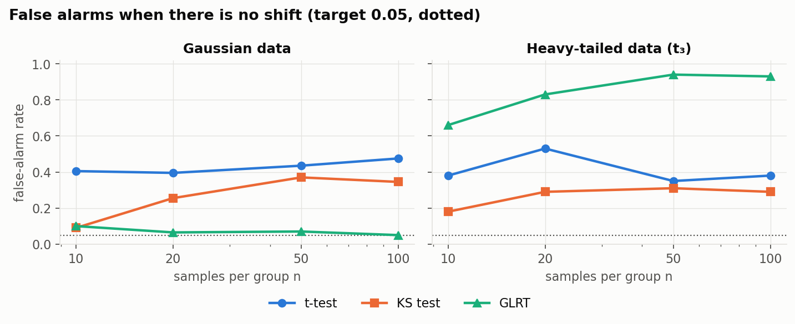
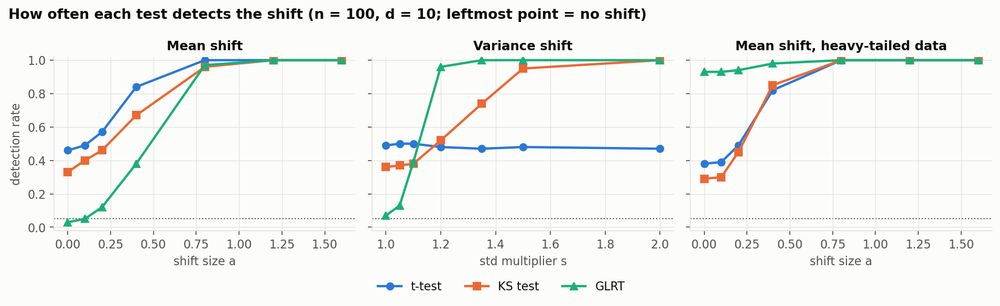
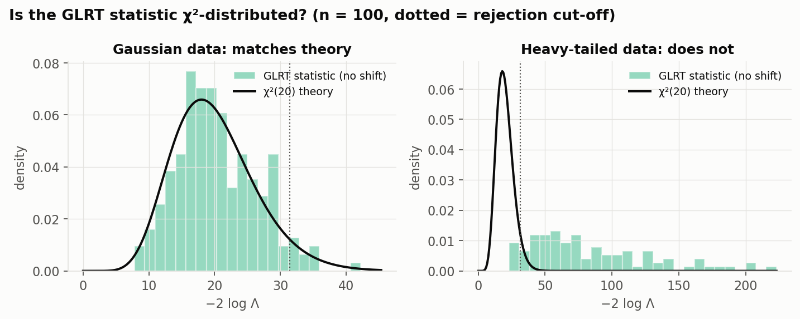

# Results

## Shifts

The reference sample is X ~ N(0, I) with d = 10. Each new sample Y changes one thing:

| Shift | What changes | Levels |
|---|---|---|
| Mean | every feature's mean moves by a/√10 | a = 0, 0.1, 0.2, 0.4, 0.8, 1.2, 1.6 |
| Variance | every feature's std is multiplied by s | s = 1, 1.05, 1.1, 1.2, 1.35, 1.5, 2 |
| Mean, heavy-tailed | same mean shift, with Student-t₃ noise instead of Gaussian | same a |

a = 0 and s = 1 mean no shift. Each setting is run 100 times with n = 10, 20, 50 and 100 samples per group.

## Tests (α = 0.05)

| Test | Compares | Rule |
|---|---|---|
| t-test | the mean of each feature | shift if any of the 10 features has p < 0.05 |
| KS | the full distribution of each feature | shift if any of the 10 features has p < 0.05 |
| GLRT | means and variances, assuming a Gaussian model | shift if −2 log Λ is above the 95th percentile of χ²(20) |

## Figures

### 1. False alarms (no shift)

- t-test and KS raise a false alarm 30–50% of the time. With 10 features each tested at 5%, at least one fires by chance about 1 − 0.95¹⁰ ≈ 40% of the time.
- On Gaussian data the GLRT stays near 5%, as it should.
- On heavy-tailed data the GLRT fails, with false alarms up to 93%.

### 2. Detection rate vs shift size (n = 100)

- **Mean shift:** all three tests reach about 100% detection by a = 0.8.
- **Variance shift:** the t-test can't see it; its rate stays at its false-alarm level. The GLRT is best, catching 96% at s = 1.2, where KS catches 52%.
- **Heavy-tailed mean shift:** the GLRT's curve starts at 93% because of false alarms, so its detections mean nothing. KS and the t-test behave the same here.

### 3. Does the GLRT follow χ²(20)? (no shift, n = 100)

- On Gaussian data the histogram matches χ²(20), so its p-values are correct.
- On heavy-tailed data the values are far larger than χ²(20) predicts. The model assumes Gaussian tails, so ordinary noise looks like a shift.

## Summary (n = 100)

| | No shift | Mean a = 0.8 | Variance s = 1.2 | Heavy-tailed, no shift |
|---|---|---|---|---|
| t-test | 0.48 | 1.00 | 0.48 | 0.38 |
| KS | 0.35 | 0.96 | 0.52 | 0.29 |
| GLRT | **0.05** | 0.97 | **0.96** | 0.93 |

**Takeaway:** the GLRT is the best test when the data is Gaussian, and it fails when it isn't. Running a test on each feature separately without a correction raises too many false alarms.

## Files

- `rejection_rates.csv`: rejection rate for each family, n, level k and test.
- `glrt_null_stats.npz`: GLRT statistics with no shift, used in figure 3.
- `figures/`: made by `../make_figures.py`.
